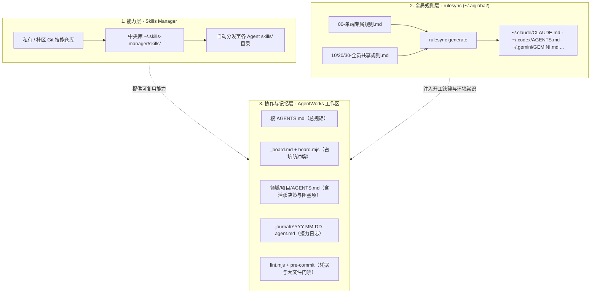

# AgentWorks Starter

> **零部署、零厂商锁定的个人多 Agent 工作流模板**：用 `Skills Manager` 管能力，用 `rulesync` 管全局规则，用 `AgentWorks` 文件夹协议管跨客户端协作、防冲突与日志交接。

当你在同一台电脑上同时使用 **Claude Code、Codex、Cursor、Antigravity (Gemini)、ZCode、WorkBuddy** 等多个 AI 客户端，且任务不只包含写代码，还覆盖**文档、视频制作、教学/研究与个人事务**时，最容易遇到三个痛点：

1. **技能散落、版本打架**：改完一个 Skill，要手工复制到五六个客户端目录。
2. **全局规则漂移**：不同客户端的 `CLAUDE.md` / `AGENTS.md` / `GEMINI.md` 越改越不一致，还会误覆盖各自的专属设定。
3. **上下文割裂、互相踩脚**：换一个 Agent 就像重带一个失忆的新实习生；两个 Agent 并行改同一目录直接冲突。

**AgentWorks Starter** 用一套**纯文件协议 + 极简跨平台零依赖 Node CLI（Windows / macOS / Linux 通吃）**把这三件事一次收口。

---

## 三层架构总览



### 核心设计哲学：把「公共契约」和「软件私有记忆」分开

| 层级 | 文件位置 | 谁能看见 | 记什么 |
|---|---|---|---|
| **全局规则** | `~/.aiglobal/.rulesync/rules/` → 多端同步 | 全部客户端 | 技能回流规矩、工作区入口、本机环境红线 |
| **工作区与项目规矩** | `AgentWorks/AGENTS.md`、`项目/AGENTS.md` | 全部客户端 | 目录结构、协作纪律、**活跃决策与阻塞项** |
| **每日交接日志** | `项目/journal/YYYY-MM-DD-agent.md` | 全部客户端 | 今天做了什么、遗留问题、下一步 |
| **软件私有长期记忆** | 各客户端自有 `MEMORY.md` / `USER.md` | 仅该客户端 | 个人偏好、聊天习惯、软件私有临时笔记 |

> 关键习惯：凡是**换了别的 Agent 也必须知道的硬结论**，不要只留在某款软件的私有记忆里，随手沉淀到项目 `AGENTS.md` 的「活跃决策与阻塞项」或对应 Skill 中。

---

## 仓库目录说明

```text
agentworks-starter/
├── init.mjs                    # 一键初始化你的本地 AgentWorks 工作区（含 Git 与 pre-commit 钩子）
├── workspace/                  # AgentWorks 工作区模板
│   ├── AGENTS.md               # 通用版工作区总规矩
│   ├── _board.md               # 看板模板（进行中占坑表 + 项目一览）
│   ├── .gitignore              # 凭据、临时文件与大媒体防泄露基线
│   ├── _template/              # 新项目最小骨架（AGENTS.md + journal/）
│   └── _tools/
│       ├── new-project.mjs     # 新建「领域/类型-主题」项目并登记看板
│       ├── board.mjs           # 看板占坑 CLI（status / claim / release / prune）
│       ├── lint.mjs            # 快慢双档体检（默认全盘 / --fast / --staged）
│       ├── lint-allow.txt      # 误报白名单
│       └── hooks/pre-commit    # Git 提交前自动阻断凭据、硬编码 key 与 >100MB 大文件
└── global-rules-template/      # ~/.aiglobal/ 的 rulesync 全局规则模板
    ├── README.md               # 多端规则同步配置指南
    ├── rulesync.jsonc          # 只同步 rules，不与 Skills Manager 抢 skills 目录
    └── .rulesync/rules/        # 按前缀拼装的模块化规则示例（00-/10-/20-/30-）
```

---

## 5 分钟快速上手

前置依赖：**Node.js 18+**、**Git**。

### 第 1 步：初始化你的 AgentWorks 工作区

```bash
git clone https://github.com/tomfocker/agentworks-starter.git
cd agentworks-starter

# 在目标路径生成全新工作区（自动 git init 并安装 pre-commit 门禁钩子）
node init.mjs ~/AgentWorks
```

进入新工作区试跑 4 条高频命令：

```bash
cd ~/AgentWorks

# 1. 新建一个项目（两层结构：领域 / 类型-主题）
node _tools/new-project.mjs --domain 代码开发 --name 工具-示例项目 --note "首个测试项目"

# 2. 开工前看板占坑（自动检测同项目重叠子目录冲突）
node _tools/board.mjs claim --project 工具-示例项目 --agent ClaudeCode --scope src/ --task "初始化架构"
node _tools/board.mjs status

# 3. 收工前秒级自查并释放占坑
node _tools/lint.mjs --fast
node _tools/board.mjs release --project 工具-示例项目 --agent ClaudeCode

# 4. 清理超过 24 小时未释放的僵尸占位
node _tools/board.mjs prune
```

### 第 2 步：配置多客户端全局规则同步（`rulesync`）

```bash
# 全局安装 rulesync
npm install -g rulesync

# 复制模板到用户级目录（请保持私人规则仅存于本地或私有仓库，勿推送到公开仓）
cp -r global-rules-template ~/.aiglobal
cd ~/.aiglobal

# 将 .rulesync/rules/ 下的 *.example.md 改名为 *.md 并填入你的真实路径与偏好
# 预演检查落盘路径，确认无误后正式生成
rulesync generate --dry-run
rulesync generate
```

详细配置说明（包括如何只同步 `rules` 避免和 Skills Manager 冲突、如何保留单客户端专属设定）见 [global-rules-template/README.md](./global-rules-template/README.md)。

### 第 3 步：搭配 Skills Manager 统一管理技能

安装 [Skills Manager](https://github.com/xingkongliang/skills-manager)（或社区 `npx skills`）统一管理 `SKILL.md` 技能分发；在 `global-rules-template/.rulesync/rules/10-skills-reflow.example.md` 中写明你的技能来源仓库，即可实现「技能改源库回流、全局规则改 `~/.aiglobal/` 同步、项目协作走 `AgentWorks`」。

---

## 这套方案在 2026 多 Agent 生态中的定位

这套模板刻意选择了**最轻、零常驻服务、代码与非代码通吃**的 Local-First 路线。如果你的场景以**纯软件工程高并发并行开发**为主，可以在这套基线之上按需叠加更重的 2.0 工具：

- **可视化 Worktree 看板**：[Vibe Kanban](https://vibekanban.com/)、Conductor
- **Git 内的结构化任务依赖记忆**：Beads
- **Agent 间异步通信与文件租约锁**：MCP Agent Mail
- **多引擎蜂群与公司级预算控制面**：Claude Code Agent Teams、Overstory、Paperclip

---

## 安全提醒

- **公开模板与个人规则务必分仓**：本模板仅含通用骨架；你的 `~/.aiglobal/` 若需跨机同步，请单独建**私有仓库**并忽略备份目录。
- **凭据底线**：API Key、Cookie、Token 优先存用户级配置目录或项目内 `.secrets/`（已被 `.gitignore` 排除，且 `pre-commit` 会自动阻断提交）。

## License

[MIT](./LICENSE)
